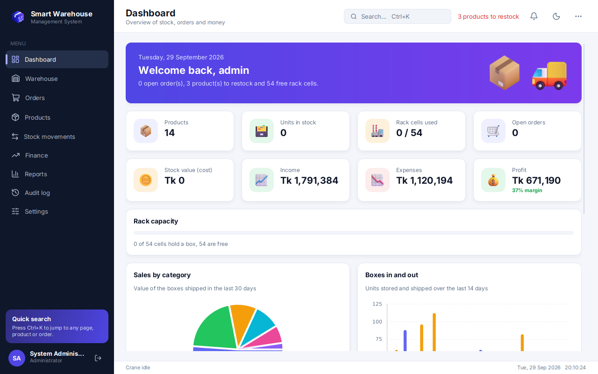
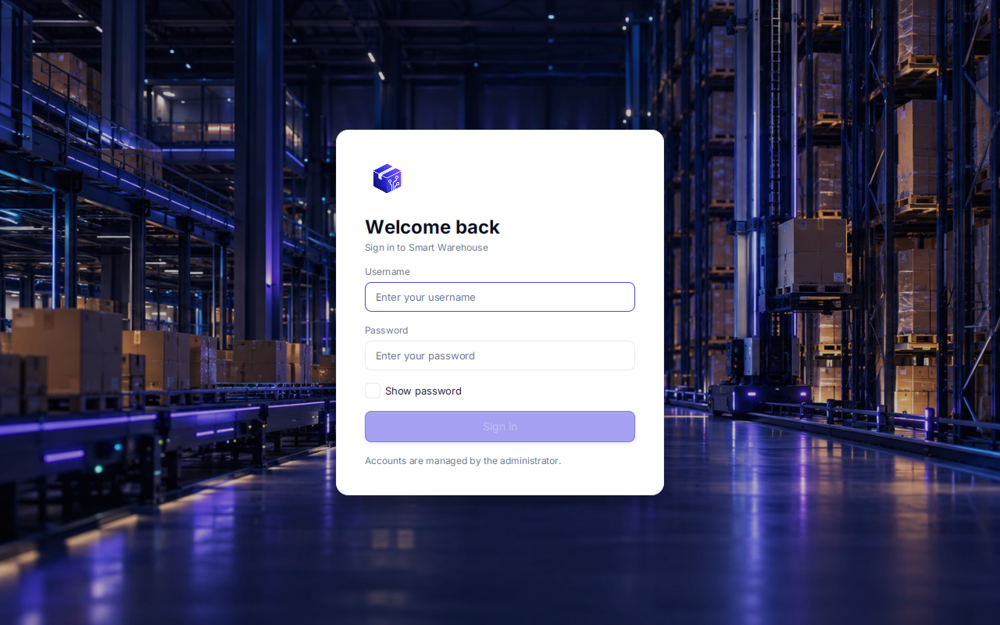
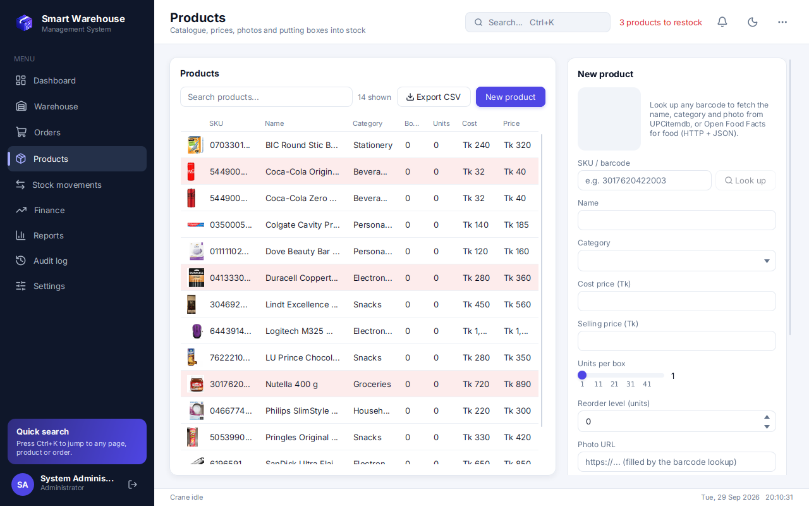
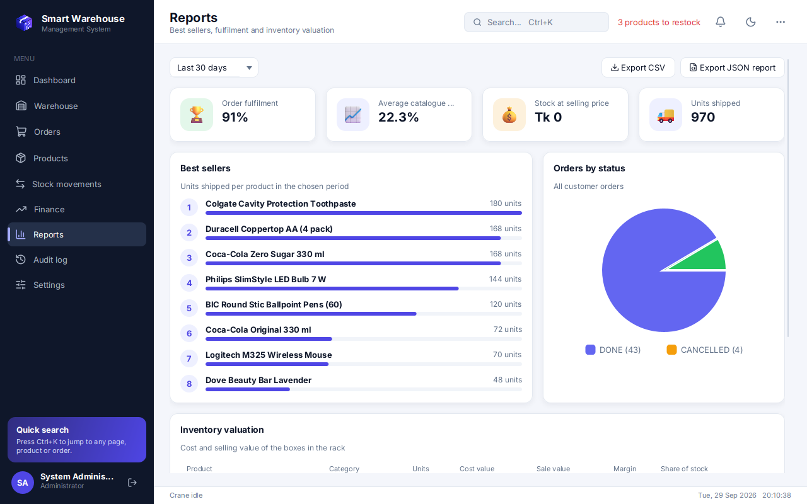
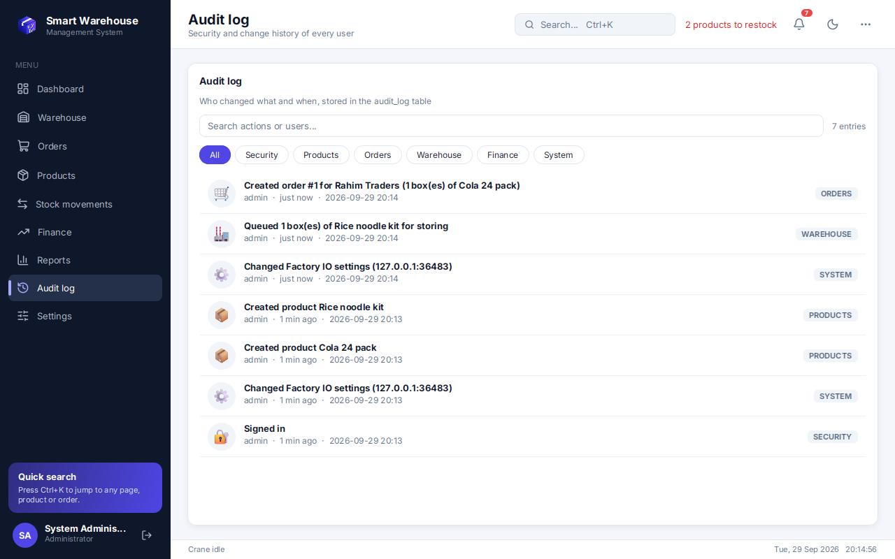
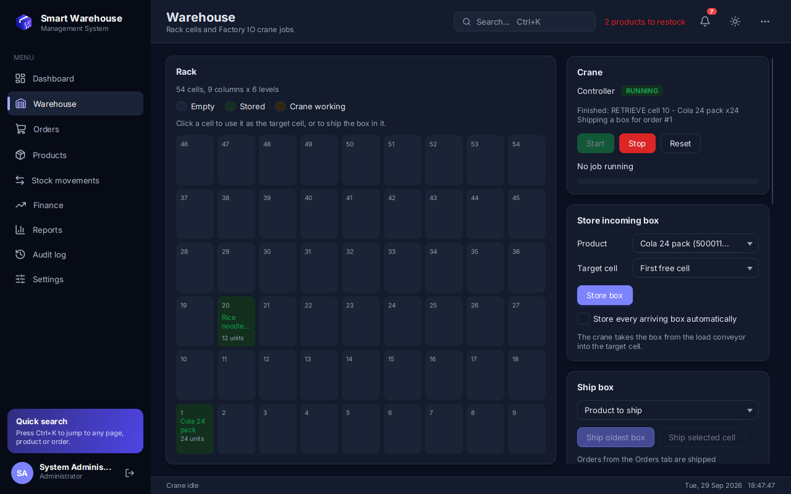
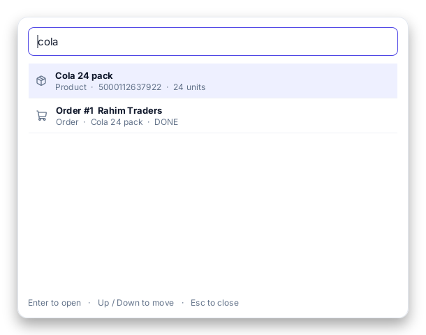

# Smart Warehouse Management System

A Java 17 / JavaFX 21 desktop application that runs a warehouse end to end:
products, stock, customer orders and finance live in SQLite, and the
**Factory IO "Automated Warehouse"** scene (stacker crane, 54 rack cells, conveyors)
is driven directly over **Modbus TCP**.

Stock only changes when the crane has actually moved a box, and every movement creates the matching finance entry.



| Login | Products with photos from the barcode lookup |
|---|---|
|  |  |
| **Reports** | **Audit log** |
|  |  |
| **Warehouse (dark mode)** | **Ctrl+K search** |
|  |  |

## Features

- **Dashboard**: greeting banner, animated KPI cards, rack capacity, stock value per category, boxes in/out per day, recent activity and restock list.
- **Products**: CRUD, barcode lookup for any retail product (name, category and photo from UPCitemdb, with Open Food Facts as fallback for food), restock highlighting, and *Put into inventory* to queue boxes for the crane right after saving a product.
- **Warehouse**: 54-cell rack, target cell (manual or first free), automatic inbound, ship by product or cell, job queue, live Modbus I/O and event log.
- **Orders**: CRUD; open orders are shipped automatically (FIFO) and booked as income.
- **Stock movements**: ledger of every box with IN/OUT filter and CSV export.
- **Finance**: income, expenses, profit, monthly chart, live exchange rates and transaction CRUD.
- **Reports**: best sellers for 7/30/90/365 days, order fulfilment, average margin, inventory valuation with share bars, CSV and JSON export.
- **Audit log** (admin): sign-ins and every change, stored in `audit_log` with category filter chips and search.
- **Settings** (admin): Factory IO connection, scene wiring, manual crane control, rack correction.
- **Everywhere**: role-based sidebar, Ctrl+K search window, notification bell, toasts, light/dark theme, keyboard shortcuts (Ctrl+1..9, Ctrl+D, F11), page transitions and animated numbers.

## Automations

| Automation | How it works |
|---|---|
| Auto connect and start | On start-up the app connects to Factory IO and switches to automatic mode. The connection (IP, port, *Save and connect*, *Disconnect*, live status) is in **Settings**. |
| Put into inventory from Products | Products → save or select a product → *Put into inventory*: number of boxes and the cell for the first box → *Store boxes*. One crane job is queued per box. |
| Inbound (manual or automatic) | Warehouse → choose the product and a **target cell** (or *First free cell*; clicking an empty cell in the rack also selects it) → *Store box*, or tick *Store every arriving box automatically*. |
| Automatic order shipping | Orders → create an order. Whenever the crane is free, it ships the oldest box of that product (FIFO). The order becomes DONE when all its boxes have left, and missing boxes are shipped as soon as they are stored. |
| Automatic bookkeeping | Storing a box books a *Purchase* expense, and shipping books a *Sales* income linked to the stock movement (one SQL transaction). |
| Restock alerts | Products at or below their reorder level turn red, and the top bar and dashboard list them. |
| Notifications and audit | A toast and a bell notification appear whenever a box is stored or shipped. Every sign-in and change is written to the audit log. |
| Live exchange rates | Finance loads rates when opened and refreshes them every 30 minutes on a scheduled thread. |
| Safety | The Factory IO Emergency stop halts all motion immediately. Reset aborts the job and restores the rack cell. A lost connection reconnects and resumes on its own. |

## Run

```bat
mvnw.cmd javafx:run
```

Or unzip `SmartWarehouse-1.0.0-win64.zip` and start `SmartWarehouse.exe` (Java is bundled).
Data lives in `%USERPROFILE%\.smart-warehouse\`: `warehouse.db` (SQLite) and `settings.json`.
A database from the previous version is upgraded automatically.

## Users

Users and their salted PBKDF2 password hashes are in the `users` table of the SQLite database.
The application has no screen to create users.

First start creates `admin / admin123`, `inventory / inventory123` and `finance / finance123`.

| Role | Pages |
|---|---|
| Administrator | all pages, including Audit log and Settings |
| Inventory Manager | Dashboard, Warehouse, Orders, Products, Stock movements, Reports |
| Finance Manager | Dashboard, Orders, Stock movements, Finance, Reports |

## Factory IO

Scene **Automated Warehouse** → *Drivers → Modbus TCP/IP Server*: Digital Inputs 15, Digital Outputs 10,
Register Outputs 1 (offsets 0), default tag order. Put the IP shown there into Settings (default `192.168.0.111`).

| Inputs | Coils |
|---|---|
| 0 At Entry, 1 At Load, 2 At Left, 3 At Middle, 4 At Right, 5 At Unload, 6 At Exit, 7 Moving X, 8 Moving Z, 9 Start, 10 Reset, 11 Stop, 12 Emergency stop, 13 Auto, 14 FACTORY I/O (Running) | 0 Entry Conveyor, 1 Load Conveyor, 2 Forks Left, 3 Forks Right, 4 Lift, 5 Unload Conveyor, 6 Exit Conveyor, 7 Start light, 8 Reset light, 9 Stop light; **holding register 0** = Target Position |

These values were measured on a running Factory IO: forks LEFT reach the load conveyor; forks RIGHT reach the rack and the
unload conveyor; conveyor sensors are TRUE when clear; cell 55 is the rest position. After restarting the scene,
use Settings → Rack correction so the database matches the empty rack.

## Lab topics in the code

| Topic | Where |
|---|---|
| Classes, objects, encapsulation | `model/*` |
| Interfaces | `Validatable`, `Repository<T>`, `PlcDriver`, `JobListener`, `SqlWork` |
| Abstract classes, inheritance, polymorphism | `BaseEntity`; `User` → `Admin`, `InventoryManager`, `FinanceManager` (`getPermissions()`); `AbstractRepository<T>` → 8 repositories; `Step` → `MoveCrane`, `Forks`, `Lift`, `Conveyor`, `ConveyorThrough`; `View` → `TableFormView<T>` → Products / Orders / Transactions |
| Generics, enums, records, exceptions | `AbstractRepository<T>`, `TableFormView<T>`, `UiThrottle<T>`; `Role`, `AuditEntry.Category`, `Sensor`, `Actuator`; `Snapshot`, `CommandPalette.Entry`, `ReportsView.ValuationLine`; `ValidationException`, `BusinessException`, `ModbusException` |
| Scenes and stages | Login scene and main scene (`Login.fxml`, `Main.fxml`), the Ctrl+K search window (second `Stage`, transparent `Scene`), dialogs, file choosers |
| Layout panes | `BorderPane`, `StackPane`, `GridPane`, `VBox`, `HBox`, `TabPane`, `ScrollPane`, `TitledPane`, `Accordion`, `TilePane`, `FlowPane` |
| UI controls | `TextField`, `PasswordField`, `CheckBox`, `RadioButton`, `ToggleButton`, `ComboBox`, `ChoiceBox`, `Spinner`, `Slider`, `DatePicker`, `TextArea`, `TableView`, `ListView`, `ProgressBar`, `ProgressIndicator`, `PieChart`, `BarChart`, `MenuButton`, `ContextMenu`, `Tooltip`, `ImageView`, `SVGPath`, `Alert`, `FileChooser` |
| Responsive layout | login card width bound to the window width (max 420 px) over a cover-scaled background image; tables use constrained column resizing; table columns bound to the table width; stat cards, charts and the rack grid use percentage constraints |
| Animation | page transitions and staggered cards (`Motion`), counting numbers (`StatBox`), sliding nav indicator, toasts, login entrance and shake on a wrong password, rack cells pop when they change, animated charts and progress bar |
| Multithreading, thread pools | `AppExecutors` (fixed pool + scheduled pool), `FxAsync` (JavaFX `Task`), 100 ms Factory IO scan, `WarehouseAutomation` (every second), `CompletableFuture.allOf` in `DashboardView`, `UiThrottle` (atomics + `Platform.runLater`), clock and exchange-rate refresh on the scheduler |
| SQLite, relationships | `schema.sql`: products→categories, rack_cells→products, sales_orders→products, stock_movements→products/rack_cells/sales_orders, transactions→stock_movements, audit_log→users; SQL transactions in `WarehouseService` |
| CRUD | Products, Orders, Transactions (create, read, update, delete) |
| HTTP + JSON | `HttpJsonClient` (`java.net.http`); barcode lookup and product photo from UPCitemdb with Open Food Facts fallback (Gson object mapping into records); exchange rates from open.er-api.com (Gson tree model); `settings.json` and the JSON report (Gson) |
| Sockets | `ModbusTcpDriver`: Modbus TCP written by hand |
| Files | CSV export of any table, JSON report, settings file |

## Credits

- Line icons: [Lucide](https://lucide.dev) (ISC), converted to SVG paths in `icons/lucide.properties`
- 3D pictures: [Microsoft Fluent Emoji](https://github.com/microsoft/fluentui-emoji) (MIT) in `img/3d`
- Login background and app logo: made for this project
- Font: [Inter](https://rsms.me/inter/) (SIL Open Font License 1.1)
